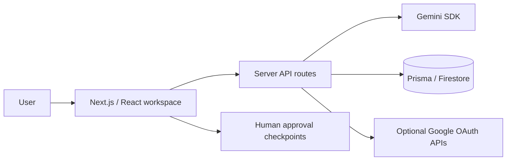

# Google Agentic Browser

<p align="center">
  <strong>From browsing pages to completing goals — with Gemini-powered plans and a human in control.</strong>
</p>


<p align="center">
  <a href="#quick-start">Quick start</a> ·
  <a href="#two-applications">Applications</a> ·
  <a href="#features">Features</a> ·
  <a href="#security-and-limitations">Security</a> ·
  <a href="#contributing">Contributing</a>
</p>

> **Independent prototype, not a Google product.** Google Agentic Browser is a Google-inspired, AI-first workspace concept by Febin Francis. It is not a Chromium browser engine or an official Google service.

**Project stage:** Working MVP / idea-stage startup · **Buildathon:** Startup Buildathon India 2026 · **Stack:** Next.js, React, TypeScript, Google Gemini SDK, Firebase, Firestore, Prisma and Google OAuth.

## Overview

Google Agentic Browser explores a different way to work across tabs, apps and AI tools: describe a goal, inspect a proposed mission, and keep a person in control of sensitive decisions.

The project includes a visual browser-workspace showcase and a separate full-stack AI Studio application. Its six agent roles are **planning personas**, not six autonomous background workers.


## Features

- **Mission planning:** Gemini-backed structured plans, chat and streaming when configured.
- **Six planning personas:** Orion (orchestration), Rover (research), Atlas (analysis), Aegis (safety), Mercury (procurement) and Chronicle (records).
- **Workspace UI:** Spaces, tabs, split panes, mission recorder and activity replay.
- **Human approval concepts:** Inspectable approval checkpoints and explicit action boundaries; showcase payments and wallets are simulations.
- **Custom Agent Studio:** Planning templates and configurable agent experiences in the full-stack app.
- **Identity and data:** Firebase sign-in and Firestore-backed user workspaces in the AI Studio application.
- **Optional Google integrations:** OAuth-connected Google Workspace capabilities, subject to configured scopes, identity, feature flags and approvals. The root showcase's Drive integration is **metadata-only and read-only**.

## Two applications

| Application | Directory | Purpose |
| --- | --- | --- |
| **Unified browser showcase** | Repository root | Neon browser-style UI, Spaces, alternative editions, Gemini planning, simulated Money OS and optional read-only Drive metadata |
| **Full-stack AI Studio** | [`apps/ai-studio/`](apps/ai-studio/README.md) | Multi-pane workspace, authenticated Gemini routes, streaming, Custom Agent Studio, Firebase/Firestore persistence and gated Workspace actions |

Each application is independently installable and normally uses port **3000**. Run them separately or configure different ports.

## Quick start

### Requirements

- **Node.js 22+** and npm
- Git
- Credentials only for the live integrations you choose to enable

### Option A — Unified browser showcase

```bash
git clone https://github.com/CodesbyFebin/Google-Agentic-Browser.git
cd Google-Agentic-Browser
npm ci
cp .env.example .env
npm run db:generate
npm run db:push
npm run dev
```

Open **http://localhost:3000**. Set `DATABASE_URL` in your local environment as described in `.env.example`; the Prisma-backed features require a prepared database. Live Gemini and Google integrations also require their respective credentials. The visual demo can still run without enabling them.

### Option B — Full-stack AI Studio

From the repository root:

```bash
cd apps/ai-studio
npm ci
cp .env.example .env.local
npm run doctor
npm run dev
```

Open **http://localhost:3000**. Add `GEMINI_API_KEY` to `apps/ai-studio/.env.local` to use live Gemini features, and configure Firebase for authenticated use. See the [AI Studio README](apps/ai-studio/README.md) and [credential guide](apps/ai-studio/CREDENTIALS.md) for the complete setup.

> **Never commit secrets.** Gemini keys, OAuth client secrets and session secrets belong in server-side environment variables or a deployment secret manager, never in `NEXT_PUBLIC_*` variables.

## Showcase routes

| Route | Workspace |
| --- | --- |
| `/` | Primary unified browser UI and Agent Studio |
| `/money` | Simulated Money OS / AgentPAL concept |
| `/agents-edition` | Alternate six-agent mission workspace |
| `/guardian` | Approval, activity and permission concepts |
| `/mission` | Mission orchestration and replay concept |
| `/classic` | Preserved Ardia/Nova-style browser shell |
| `/reference/mission-control-demo.html` | Original HTML reference |

The root showcase can also be viewed as a static design demo by serving `public/` and opening `google-agentic-browser.html`. Server-backed features are not available in that mode.

## Architecture



The two applications have different implementations and security boundaries. Consult [AI Studio architecture](apps/ai-studio/ARCHITECTURE.md), [integration notes](docs/INTEGRATION.md) and [Phase 2 notes](docs/PHASE2.md) before adapting either for production.

## Configuration

The checked-in `.env.example` files are the source of truth for each application's environment settings.

| Integration | Example settings | Notes |
| --- | --- | --- |
| Root database | `DATABASE_URL` | Needed for Prisma-backed APIs |
| Gemini | `GEMINI_API_KEY`, optional `GEMINI_MODEL` | Server-only; model access depends on your account |
| Google OAuth | `GOOGLE_OAUTH_CLIENT_ID`, `GOOGLE_OAUTH_CLIENT_SECRET`, `GOOGLE_OAUTH_REDIRECT_URI` | Configure exact authorized redirect URI |
| Session security | `GOOGLE_SESSION_SECRET` | Use a strong random secret in production |
| Firebase | `NEXT_PUBLIC_FIREBASE_*` | Public web-app identifiers; deploy owner-only Firestore rules |

The root showcase requests read-only Drive metadata scopes when its optional Google connection is configured. It does not retrieve Drive document contents for mission planning. AI Studio's separate Workspace capabilities require additional security controls; see its documentation before enabling writes.

## Testing and CI

For the **root** application:

```bash
npm run lint
npm run typecheck
npm run test
npm run build
```

For **AI Studio**, run its documented checks from `apps/ai-studio/`. The repository's existing [quality-gates workflow](.github/workflows/ci.yml) checks both applications.

Additional security and maintenance workflows are proposed in [PR #6](https://github.com/CodesbyFebin/Google-Agentic-Browser/pull/6); they are not represented here as already merged into `main`.

## Security and limitations

**This is a prototype, not a production-ready autonomous browser.**

- The interface does **not** provide a real Chromium navigation engine or general-purpose browser automation.
- Showcase payments, wallets, approval dialogs and mission playback are **simulated**; no live payment transfers are implemented.
- Gemini calls require server-side configuration and applicable authentication/quotas. Do not expose an API key in client code.
- The root application's Google Drive integration is **read-only metadata access**. It does not send document contents to Gemini.
- AI Studio has authenticated API routes and action-specific approval mechanisms, but production deployment still requires review of identity, permissions, quotas, OAuth consent and data lifecycle.
- Do not enable live Google Workspace writes for public use without a dedicated security review.
- Demo state may be browser-local or process-local; do not treat it as durable production storage.

See [SECURITY.md](https://github.com/CodesbyFebin/Google-Agentic-Browser/blob/chore/security-community-hardening-20261115/SECURITY.md) in the proposed hardening branch for vulnerability reporting guidance.

## Project structure

```text
Google-Agentic-Browser/
├── apps/ai-studio/       # Separate full-stack AI Studio app
├── docs/                 # Architecture, integration and setup notes
├── prisma/               # Root app database schema
├── public/               # Browser showcase assets and HTML
├── src/                  # Root Next.js source and API routes
├── tests/                # Root app checks and smoke tests
├── .github/workflows/    # CI configuration
├── .env.example          # Root environment variable template
└── README.md
```

## Roadmap

- [ ] Validate the concept with founders and researchers
- [ ] Expand meaningful tests for authentication and approval boundaries
- [ ] Add durable per-user AI quotas and budget monitoring
- [ ] Complete production OAuth consent and credentialed integration testing
- [ ] Harden data retention, deployments and monitoring
- [ ] Explore real browser navigation only after designing a secure execution sandbox

These are goals, **not implemented features**.

## Contributing

Issues and pull requests are welcome. Read [CONTRIBUTING.md](https://github.com/CodesbyFebin/Google-Agentic-Browser/blob/chore/security-community-hardening-20261115/CONTRIBUTING.md) on the proposed hardening branch for development and testing guidelines.

- [Report a bug](https://github.com/CodesbyFebin/Google-Agentic-Browser/issues)
- [Open a pull request](https://github.com/CodesbyFebin/Google-Agentic-Browser/pulls)
- [View the security and contributor improvements](https://github.com/CodesbyFebin/Google-Agentic-Browser/pull/6)

## License

**No license has been selected yet.** Public source availability does not itself grant permission to reuse or redistribute the code. The maintainer should choose and add a license before describing the project as open-source.

---

<p align="center">
  <strong>Google Agentic Browser</strong><br />
  Plan with AI. Inspect the steps. Keep humans in control.
</p>
