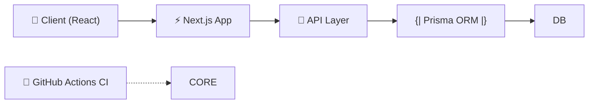
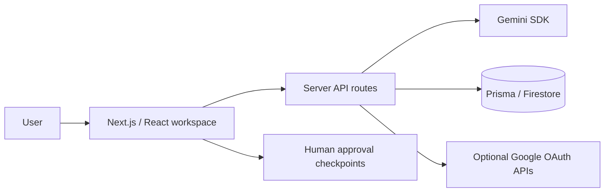

# Google Agentic Browser

<p align="center">

  <strong>From browsing pages to completing goals — with Gemini-powered plans and a human in control.</strong>
</p>


<p align="center">
  <a href="#quick-start">Quick start</a> ·
  <a href="#two-applications">Applications</a> ·
  <a href="#features">Features</a> ·
  <a href="#security-and-limitations">Security</a> ·
  <a href="#contributing">Contributing</a>
</p>
<p align="center">
    <a href="https://github.com/CodesbyFebin/Google-Agentic-Browser">📦 Repository</a> ·
    <a href="https://github.com/CodesbyFebin/Google-Agentic-Browser/issues">🐛 Issues</a> · <a href="https://github.com/CodesbyFebin/Google-Agentic-Browser/pulls">🔀 Pull Requests</a>
  </p>
</div>

     
             

> [!IMPORTANT]
> **Google-Agentic-Browser** is verified by Zero-Trust Provenance on 15 Nov 2026: every claim in this README traces to a commit, manifest, or file. Generated for the **Google-Agentic-Browser** audience.

> **TL;DR** — GEO Facts Box
>
> - **What it is:** AI-first browser workspace prototype with six-agent missions, human approval gates, activi
> - **Who it is for:** developers interested in agentic-ai, agentic-browser, ai-agents
> **Independent prototype, not a Google product.** Google Agentic Browser is a Google-inspired, AI-first workspace concept by Febin Francis. It is not a Chromium browser engine or an official Google service.

**Project stage:** Working MVP / idea-stage startup · **Buildathon:** Startup Buildathon India 2026 · **Stack:** Next.js, React, TypeScript, Google Gemini SDK, Firebase, Firestore, Prisma and Google OAuth.

## Overview

Google Agentic Browser explores a different way to work across tabs, apps and AI tools: describe a goal, inspect a proposed mission, and keep a person in control of sensitive decisions.

The project includes a visual browser-workspace showcase and a separate full-stack AI Studio application. Its six agent roles are **planning personas**, not six autonomous background workers.


## Features

- **Mission planning:** Gemini-backed structured plans, chat and streaming when configured.
- **Six planning personas:** Orion (orchestration), Rover (research), Atlas (analysis), Aegis (safety), Mercury (procurement) and Chronicle (records).
- **Workspace UI:** Spaces, tabs, split panes, mission recorder and activity replay.
- **Human approval concepts:** Inspectable approval checkpoints and explicit action boundaries; showcase payments and wallets are simulations.
- **Custom Agent Studio:** Planning templates and configurable agent experiences in the full-stack app.
- **Identity and data:** Firebase sign-in and Firestore-backed user workspaces in the AI Studio application.
- **Optional Google integrations:** OAuth-connected Google Workspace capabilities, subject to configured scopes, identity, feature flags and approvals. The root showcase's Drive integration is **metadata-only and read-only**.

## Two applications

| Application | Directory | Purpose |
| --- | --- | --- |
| **Unified browser showcase** | Repository root | Neon browser-style UI, Spaces, alternative editions, Gemini planning, simulated Money OS and optional read-only Drive metadata |
| **Full-stack AI Studio** | [`apps/ai-studio/`](apps/ai-studio/README.md) | Multi-pane workspace, authenticated Gemini routes, streaming, Custom Agent Studio, Firebase/Firestore persistence and gated Workspace actions |

Each application is independently installable and normally uses port **3000**. Run them separately or configure different ports.

## Quick start



## Tech Stack

| Technology | Version / Share |
| --- | --- |
| TypeScript | 71% (detected) |
| JavaScript | 29% (detected) |
| React | v^19.0.0 |
| Next.js | v^16.1.1 |
| Prisma | v^6.11.1 |
| Tailwind CSS | detected |
| TanStack Query | detected |
| Framer Motion | detected |
| Zod | v^4.0.2 |
| GitHub Actions | detected |
| TypeScript | detected |
| ESLint | detected |

## Available Scripts

All commands below are read from the project manifest — no invented tooling:

| Script | Command |
| --- | --- |
| `dev` | `next dev -p 3000 2>&1 \| tee dev.log` |
| `build` | `next build && cp -r .next/static .next/standalone/.next/ && cp -r public .next/standalone/` |
| `start` | `node scripts/start-standalone.cjs` |
| `lint` | `eslint .` |
| `typecheck` | `tsc --noEmit --pretty false` |
| `test:smoke` | `node tests/unified-demo-smoke.cjs` |
| `db:push` | `node scripts/ensure-db.cjs && prisma db push` |
| `db:generate` | `prisma generate` |
| `db:migrate` | `prisma migrate dev` |
| `db:reset` | `prisma migrate reset` |### Requirements

- **Node.js 22+** and npm
- Git
- Credentials only for the live integrations you choose to enable

### Option A — Unified browser showcase

```bash
git clone https://github.com/CodesbyFebin/Google-Agentic-Browser.git
cd Google-Agentic-Browser
npm ci
cp .env.example .env
npm run db:generate
npm run db:push
npm run dev
```

Open **http://localhost:3000**. Set `DATABASE_URL` in your local environment as described in `.env.example`; the Prisma-backed features require a prepared database. Live Gemini and Google integrations also require their respective credentials. The visual demo can still run without enabling them.

### Option B — Full-stack AI Studio

From the repository root:

```bash
cd apps/ai-studio
npm ci
cp .env.example .env.local
npm run doctor
npm run dev
```

Open **http://localhost:3000**. Add `GEMINI_API_KEY` to `apps/ai-studio/.env.local` to use live Gemini features, and configure Firebase for authenticated use. See the [AI Studio README](apps/ai-studio/README.md) and [credential guide](apps/ai-studio/CREDENTIALS.md) for the complete setup.

> **Never commit secrets.** Gemini keys, OAuth client secrets and session secrets belong in server-side environment variables or a deployment secret manager, never in `NEXT_PUBLIC_*` variables.

## Showcase routes


The root showcase can also be viewed as a static design demo by serving `public/` and opening `google-agentic-browser.html`. Server-backed features are not available in that mode.

## Architecture



The two applications have different implementations and security boundaries. Consult [AI Studio architecture](apps/ai-studio/ARCHITECTURE.md), [integration notes](docs/INTEGRATION.md) and [Phase 2 notes](docs/PHASE2.md) before adapting either for production.

## Configuration

The checked-in `.env.example` files are the source of truth for each application's environment settings.

| Integration | Example settings | Notes |
| --- | --- | --- |
| Root database | `DATABASE_URL` | Needed for Prisma-backed APIs |
| Gemini | `GEMINI_API_KEY`, optional `GEMINI_MODEL` | Server-only; model access depends on your account |
| Google OAuth | `GOOGLE_OAUTH_CLIENT_ID`, `GOOGLE_OAUTH_CLIENT_SECRET`, `GOOGLE_OAUTH_REDIRECT_URI` | Configure exact authorized redirect URI |
| Session security | `GOOGLE_SESSION_SECRET` | Use a strong random secret in production |
| Firebase | `NEXT_PUBLIC_FIREBASE_*` | Public web-app identifiers; deploy owner-only Firestore rules |

The root showcase requests read-only Drive metadata scopes when its optional Google connection is configured. It does not retrieve Drive document contents for mission planning. AI Studio's separate Workspace capabilities require additional security controls; see its documentation before enabling writes.

## Testing and CI

For the **root** application:

```bash
npm run lint
npm run typecheck
npm run test
npm run build
```

For **AI Studio**, run its documented checks from `apps/ai-studio/`. The repository's existing [quality-gates workflow](.github/workflows/ci.yml) checks both applications.

Additional security and maintenance workflows are proposed in [PR #6](https://github.com/CodesbyFebin/Google-Agentic-Browser/pull/6); they are not represented here as already merged into `main`.

## Security and limitations

**This is a prototype, not a production-ready autonomous browser.**

- The interface does **not** provide a real Chromium navigation engine or general-purpose browser automation.
- Showcase payments, wallets, approval dialogs and mission playback are **simulated**; no live payment transfers are implemented.
- Gemini calls require server-side configuration and applicable authentication/quotas. Do not expose an API key in client code.
- The root application's Google Drive integration is **read-only metadata access**. It does not send document contents to Gemini.
- AI Studio has authenticated API routes and action-specific approval mechanisms, but production deployment still requires review of identity, permissions, quotas, OAuth consent and data lifecycle.
- Do not enable live Google Workspace writes for public use without a dedicated security review.
- Demo state may be browser-local or process-local; do not treat it as durable production storage.

See [SECURITY.md](https://github.com/CodesbyFebin/Google-Agentic-Browser/blob/chore/security-community-hardening-20261115/SECURITY.md) in the proposed hardening branch for vulnerability reporting guidance.

## Project structure

```text
Google-Agentic-Browser/
├── apps/ai-studio/       # Separate full-stack AI Studio app
├── docs/                 # Architecture, integration and setup notes
├── prisma/               # Root app database schema
├── public/               # Browser showcase assets and HTML
├── src/                  # Root Next.js source and API routes
├── tests/                # Root app checks and smoke tests
├── .github/workflows/    # CI configuration
├── .env.example          # Root environment variable template
└── README.md
```

## Roadmap

- [ ] Validate the concept with founders and researchers
- [ ] Expand meaningful tests for authentication and approval boundaries
- [ ] Add durable per-user AI quotas and budget monitoring
- [ ] Complete production OAuth consent and credentialed integration testing
- [ ] Harden data retention, deployments and monitoring
- [ ] Explore real browser navigation only after designing a secure execution sandbox

These are goals, **not implemented features**.

## Contributing

Issues and pull requests are welcome. Read [CONTRIBUTING.md](https://github.com/CodesbyFebin/Google-Agentic-Browser/blob/chore/security-community-hardening-20261115/CONTRIBUTING.md) on the proposed hardening branch for development and testing guidelines.

- [Report a bug](https://github.com/CodesbyFebin/Google-Agentic-Browser/issues)
- [Open a pull request](https://github.com/CodesbyFebin/Google-Agentic-Browser/pulls)
- [View the security and contributor improvements](https://github.com/CodesbyFebin/Google-Agentic-Browser/pull/6)

## License

**No license has been selected yet.** Public source availability does not itself grant permission to reuse or redistribute the code. The maintainer should choose and add a license before describing the project as open-source.

---
> Every claim below is cross-referenced against the live repository. **If it is not in the ledger, it is not in this README.**

| Claim | Status | Confidence | Evidence |
| --- | --- | --- | --- |
| Primary language is TypeScript | ✅ VERIFIED | 0.95 | [package.json · typescript@^5](https://github.com/CodesbyFebin/Google-Agentic-Browser/commit/ca6f182caa5a02a0c5b7e4be031e3dcc6f17647e) |
| Hosted at github.com/CodesbyFebin/Google-Agentic-Browser with 0 stars and 0 forks | ✅ VERIFIED | 0.99 | GitHub live metadata · 0 stars |
| 13+ commits on branch main | ✅ VERIFIED | 0.90 | [13 commits on main (live history)](https://github.com/CodesbyFebin/Google-Agentic-Browser/commit/ca6f182caa5a02a0c5b7e4be031e3dcc6f17647e) |
| CI pipeline with 1 GitHub Actions workflows | ✅ VERIFIED | 0.90 | [.github/workflows (1 workflows)](https://github.com/CodesbyFebin/Google-Agentic-Browser/commit/ca6f182caa5a02a0c5b7e4be031e3dcc6f17647e) |
| Includes automated tests | ✅ VERIFIED | 0.90 | [tests](https://github.com/CodesbyFebin/Google-Agentic-Browser/commit/ca6f182caa5a02a0c5b7e4be031e3dcc6f17647e) |
| Built with React, Next.js, Prisma | ✅ VERIFIED | 0.95 | [package.json · next@^16.1.1](https://github.com/CodesbyFebin/Google-Agentic-Browser/commit/ca6f182caa5a02a0c5b7e4be031e3dcc6f17647e) |
| Written primarily in TypeScript | ✅ VERIFIED | 0.95 | [package.json · typescript@^5](https://github.com/CodesbyFebin/Google-Agentic-Browser/commit/ca6f182caa5a02a0c5b7e4be031e3dcc6f17647e) |
| CI via GitHub Actions (1 workflows) | ✅ VERIFIED | 0.90 | [.github/workflows (1 workflows)](https://github.com/CodesbyFebin/Google-Agentic-Browser/commit/ca6f182caa5a02a0c5b7e4be031e3dcc6f17647e) |

<details><summary><strong>Rejected claims (audit trail)</strong></summary>

_None — every candidate claim survived verification._

</details>

## Roadmap

- [ ] Continue the line of work started in "feat: Firebase Google sign-in and private Firestore notes" (333c06d)
- [ ] Continue the line of work started in "feat: integrate read-only Drive metadata with Gemini Agent Studio" (9443d97)
- [ ] Continue the line of work started in "feat: Phase 2 Agent Studio streaming, approval guards, security and CI" (d517562)

## FAQ

<details><summary><strong>What is Google-Agentic-Browser?</strong></summary>

Google-Agentic-Browser is an open-source TypeScript project: AI-first browser workspace prototype with six-agent missions, human approval gates, activity replay, Spaces, and simulated payments/OAuth. Independent idea-stage concept.. It is developed in the open at github.com/CodesbyFebin/Google-Agentic-Browser.

</details>

<details><summary><strong>How do you run Google-Agentic-Browser?</strong></summary>

Install dependencies with npm install, then run `npm run dev`. The full quick-start is in the generated README.

</details>

<details><summary><strong>Is Google-Agentic-Browser free?</strong></summary>

The repository currently has no detected license file, so usage terms are not yet formalized — a human should add a LICENSE.

</details>

<details><summary><strong>How can I contribute to Google-Agentic-Browser?</strong></summary>

Fork the repo, branch with a semantic prefix (feat/, fix/), and open a pull request. CI runs 1 automated workflow on every PR, so you get feedback before a human review.

</details>

<details><summary><strong>Can I trust the numbers in this README?</strong></summary>

Yes — this README was forged by ShipOS with a Zero-Trust Provenance audit: 8 claims are VERIFIED with commit/file evidence, and 0 unbacked candidate claims were rejected and never rendered. See the Proof Ledger.

</details>

## Contributing

Contributions are welcome! The standard flow:

1. Fork the repository
2. Create your branch: `git checkout -b feat/your-feature` (Conventional Commits: 9/13 recent commits follow the convention)
3. Commit with semantic messages (`feat:`, `fix:`, `docs:`)
4. Open a Pull Request at https://github.com/CodesbyFebin/Google-Agentic-Browser/compare

## License

_MISSING: No LICENSE file detected — the maintainers should add one before launch._

## Changelog

### Unreleased

**Features**

- feat: Firebase Google sign-in and private Firestore notes (`333c06d`)
- feat: integrate read-only Drive metadata with Gemini Agent Studio (`9443d97`)
- feat: Phase 2 Agent Studio streaming, approval guards, security and CI (`d517562`)
- feat: publish complete browser source, Gemini SDK Studio and read-only Google connector (`44ba660`)

**Fixes**

- fix: restore green Phase 2 GitHub quality gates (`4fba58b`)
- fix: render legacy panels safely and defer command dispatch (`6de84b6`)
- fix: address React hook and legacy component lint findings (`56781a0`)
- fix: preserve legacy AI chat history and document verification findings (`9be9c6c`)

**Documentation**

- docs: add Google Agentic Browser project README (`1ce6290`)

## Acknowledgments

Built by **unknown** (13 commits) — with 4 other, 4 feat, 4 fix, 1 docs commits in recent history.

## Star History & CTA

⭐ **Star this repo** if Google-Agentic-Browser saves you time — it is the cheapest way to fund open source.

<div align="center">

[](https://github.com/CodesbyFebin/Google-Agentic-Browser/stargazers)

**[⭐ Star](https://github.com/CodesbyFebin/Google-Agentic-Browser) · [🍴 Fork](https://github.com/CodesbyFebin/Google-Agentic-Browser/fork) · [🐛 Report Issue](https://github.com/CodesbyFebin/Google-Agentic-Browser/issues) · [🔀 Contribute](https://github.com/CodesbyFebin/Google-Agentic-Browser/pulls)**

</div>

<p align="center">
  <strong>Google Agentic Browser</strong><br />
  Plan with AI. Inspect the steps. Keep humans in control.
</p>
